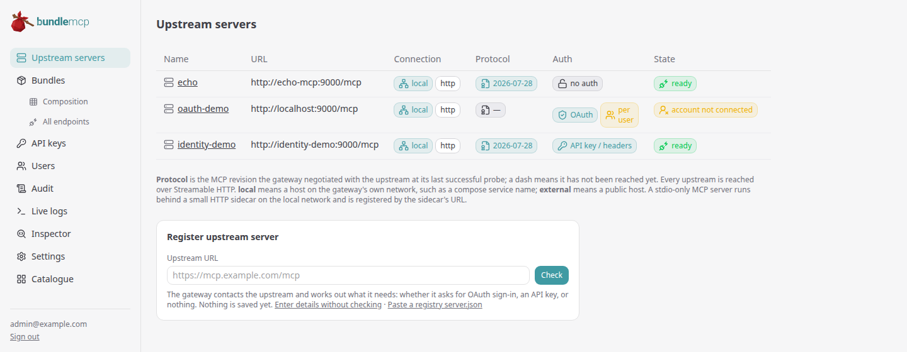
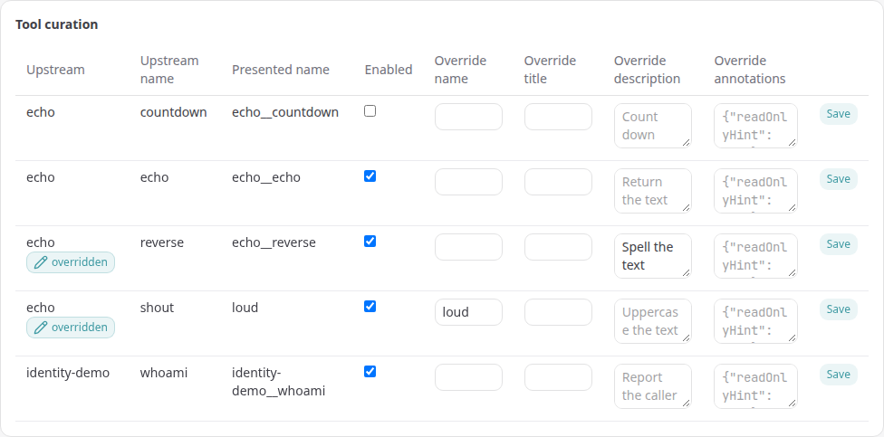

<p align="center">
  
</p>

<p align="center">
  <a href="https://github.com/wingfold-ai/bundlemcp/actions/workflows/ci.yml"></a>
  <a href="https://github.com/wingfold-ai/bundlemcp/releases"></a>
  <a href="LICENSE"></a>
  <a href="https://bundlemcp.dev"></a>
</p>

**Your self-hosted MCP servers, in claude.ai and ChatGPT, behind one endpoint and one login.**

> **Status: public preview (v0.4).** It runs the maintainer's own MCP servers every day, but the management API,
> settings and bootstrap format may still change before 1.0. Breaking changes are called out in the
> [changelog](CHANGELOG.md).

bundlemcp is a self-hostable MCP gateway. Register your MCP servers, bundle their tools, and give each client the
endpoint it needs: OAuth for claude.ai and ChatGPT, API keys for scripts and agents. Your servers need no login of
their own, and you decide which tools each bundle shows and how they are named.

**[Documentation](https://bundlemcp.dev)** · [Quickstart](#quickstart) · [Roadmap](https://bundlemcp.dev/roadmap)

<p align="center">
  
</p>

- **One login.** A built-in OAuth 2.1 server that claude.ai and ChatGPT connect to, admin sign-in through any OIDC
  provider, and API keys for scripts.
- **Bundles.** Many servers behind one endpoint, their tool names prefixed so they never collide. Changes apply live.
- **Tool curation.** Hide, rename or re-describe each tool per bundle, and shape each endpoint for its client.
- **Spec bridging.** Each server is negotiated on its own, so older and newer MCP clients and servers work together.
- **Restart-safe.** Sessions live in Valkey and configuration in Postgres, so any replica serves any session.

<p align="center">
  
</p>

## How it compares

As of November 2026; these projects move fast, so corrections are welcome.

| | What it does well | Where bundlemcp differs |
|---|---|---|
| [metamcp](https://github.com/metatool-ai/metamcp) | Bundles servers behind one endpoint, with API-key and OIDC auth (MIT). bundlemcp began as a rewrite of its bundling core. | Restart-safe sessions, several replicas, and new MCP spec revisions as they come. An importer for metamcp setups is [on the roadmap](https://bundlemcp.dev/roadmap). |
| [IBM ContextForge](https://github.com/IBM/mcp-context-forge) | The most complete option: gateway, registry, virtual servers, rate limiting and a choice of protocol version (Apache 2.0). | A narrower scope (bundling, auth and tool curation for hosted clients), so less to set up and run. |
| [MCPJungle](https://github.com/mcpjungle/MCPJungle), [Docker MCP Gateway](https://github.com/docker/mcp-gateway) | Bundle servers behind one endpoint for local clients and bearer tokens. | An OAuth server that claude.ai and ChatGPT can sign in through, and tools curated per bundle. |
| Auth-only proxies ([mcp-front](https://github.com/dgellow/mcp-front), [mcp-oauth-gateway](https://github.com/atrawog/mcp-oauth-gateway)) | Put OAuth in front of an MCP server for claude.ai. | Many servers behind one login, with their tools curated per bundle. |

## Quickstart

Prerequisites: Docker with the compose plugin, and ports 8000, 3000, 8080, 9000 and 9100 free.

```bash
cp deploy/.env.example deploy/.env
docker compose -f deploy/docker-compose.yml --env-file deploy/.env \
  up -d --build --wait --wait-timeout 300
```

Then:

1. Open the admin UI at <http://localhost:3000> and sign in through the bundled dev identity provider with `admin` /
   `admin`.
2. The seed (`deploy/seed.yaml`) has already registered the `echo` example server, bundled it as `demo`, and exposed it
   at the `demo` endpoint with API-key access. Call it with the dev service key — a hand-built request carries the
   stateless-era envelope, which an SDK would supply for you
   ([request envelope](docs/integrate/http-surface.md#request-envelope)):

   ```bash
   KEY=bmcp_sk_devservicekey000000000000000000000000
   V=2026-07-28
   curl -s http://localhost:8000/demo/mcp \
     -H "Authorization: Bearer $KEY" -H "Content-Type: application/json" \
     -H "MCP-Protocol-Version: $V" -H "Mcp-Method: tools/list" \
     -d '{"jsonrpc":"2.0","id":1,"method":"tools/list","params":{"_meta":{
           "io.modelcontextprotocol/protocolVersion":"'"$V"'",
           "io.modelcontextprotocol/clientCapabilities":{}}}}'
   ```

   The seed also registers `oauth-demo`, an OAuth-protected example upstream, and two more endpoints on the `demo`
   bundle (`claude` and `chatgpt`), and `identity-demo`, which reports what an upstream learns about its caller, on an
   `identity` endpoint of its own.
3. Connect claude.ai to the seeded `claude` endpoint; the gateway runs the OAuth authorization server and the consent
   screen itself. claude.ai needs a public HTTPS URL, so start the stack with `deploy/stack.sh up`, which adds a tunnel
   and prints the URL to paste ([quickstart](docs/guide/quickstart.md)).

The user guides (deployment, connecting clients, the management API) live in [docs/](docs/README.md); run
`npm run docs:install && npm run docs:dev` to browse them. The management API is documented at
<http://localhost:8000/api/v1/docs>. Testing against the full stack is covered in
[deploy/TESTING.md](deploy/TESTING.md).

## Under the hood

bundlemcp registers upstream MCP servers over Streamable HTTP and exposes each bundle through one or more endpoints,
each with a profile for its client. Sessions, rate limits and cross-replica signalling live in Valkey; configuration,
tokens and the audit log in Postgres, so a restart or a second replica is a non-event. It is a focused rewrite of the
bundling core of metamcp, built to be consumed by an application layer that adds its own identity provider, billing
and discovery, and fully usable on its own with any OIDC provider.

## Where things are

| | |
|---|---|
| [docs/](docs/README.md) | The user documentation site (VitePress): self-hosting, managing servers/bundles/endpoints, connecting claude.ai, ChatGPT and scripts, integrating an application layer — `npm run docs:install && npm run docs:dev` |
| [openspec/](openspec/README.md) | The source of truth, kept with OpenSpec: one spec per capability with testable requirement IDs, open change proposals, and the decision log of what was deliberately left out |
| [docs/arc42/](docs/arc42/) | Architecture rationale, arc42 sections |
| [docs/adr/](docs/adr/README.md) | Architecture decision records, append-only |
| [docs/likec4/](docs/likec4/) | Diagrams as a LikeC4 model |
| [packages/bundlemcp/](packages/bundlemcp/) | The library: services, the OAuth server, the MCP edge, the management API |
| [apps/gateway/](apps/gateway/) | The gateway entrypoint |
| [apps/web/](apps/web/) | The Nuxt admin UI |
| [deploy/](deploy/) | The compose stack, the dev Keycloak realm, the demo seed |

## Development

```bash
uv sync --all-packages
uv run pytest -q          # hermetic unit tests: in-memory SQLite + fakeredis
uv run ruff check .
uv run lint-imports       # the layer contract
uv run rumdl check .      # Markdown, 120 columns (`rumdl fmt .` rewraps)
cd apps/web && npm ci && npm run openapi && npm run typecheck
```

`npm run openapi` regenerates `apps/web/openapi.json` and `apps/web/types/api.d.ts`, which are a CI gate — run it after
any change to a DTO or a route. `npm run typecheck` passes while that gate fails.

Documentation consistency is checked too, over the files the VitePress build does not see:

```bash
python3 tools/check_docs_links.py     # relative links and heading anchors
python3 tools/check_docs_symbols.py   # the living docs name no dead symbols
python3 tools/check_docs_settings.py  # env vars and requirement IDs are real
python3 tools/check_adr_graph.py      # ADR statuses and both indexes agree
```

Integration and browser tests run against the compose stack; see [deploy/TESTING.md](deploy/TESTING.md).

## Contributing

Contributions are welcome. **Start here:** [CONTRIBUTING.md](CONTRIBUTING.md) — the read order, the change checklist,
how to add a migration and how to debug. The coding conventions, which AI coding assistants read too, are in
[CLAUDE.md](CLAUDE.md) and [.claude/docs/](.claude/docs/). Report security problems privately
as described in [SECURITY.md](SECURITY.md). Everyone taking part follows the [Code of Conduct](CODE_OF_CONDUCT.md).

## License

bundlemcp is licensed under the [Apache License 2.0](LICENSE).
