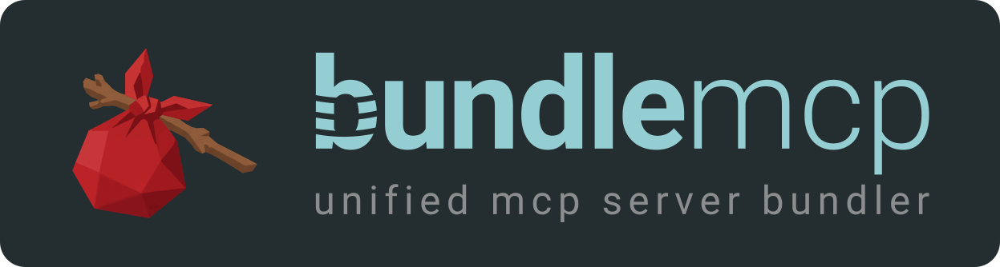

<p align="center">
  
</p>

A self-hostable **MCP bundling gateway**. Register upstream MCP servers (Streamable HTTP), compose them into
**bundles**, and expose each bundle through one or more **endpoints** shaped for the client that will use it: an OAuth
profile for claude.ai, a re-annotation profile for ChatGPT, API-key access for scripts. One gateway, any number of
replicas: sessions, rate limits and cross-replica signalling live in Valkey, configuration, tokens and the audit log in
Postgres, so a restart or a second replica is a non-event.

It is a focused rewrite of the bundling core of [metamcp](https://github.com/metatool-ai/metamcp), built to be consumed
by an application layer that adds its own identity provider, billing and discovery, but fully usable on its own with any
OIDC provider.

## Quickstart

Prerequisites: Docker with the compose plugin, and ports 8000, 3000 and 8080 free.

```bash
cp deploy/.env.example deploy/.env
docker compose -f deploy/docker-compose.yml --env-file deploy/.env \
  up -d --build --wait --wait-timeout 300
```

Then:

1. Open the admin UI at <http://localhost:3000> and sign in through the bundled dev identity provider with `admin` /
   `admin`.
2. The seed (`deploy/seed.yaml`) has already registered the `echo` example server, bundled it as `demo`, and exposed it
   at the `demo` endpoint with API-key access. Call it with the dev service key — a hand-built request carries the
   stateless-era envelope, which an SDK would supply for you
   ([request envelope](docs/integrate/http-surface.md#request-envelope)):

   ```bash
   KEY=bmcp_sk_devservicekey000000000000000000000000
   V=2026-07-28
   curl -s http://localhost:8000/demo/mcp \
     -H "Authorization: Bearer $KEY" -H "Content-Type: application/json" \
     -H "MCP-Protocol-Version: $V" -H "Mcp-Method: tools/list" \
     -d '{"jsonrpc":"2.0","id":1,"method":"tools/list","params":{"_meta":{
           "io.modelcontextprotocol/protocolVersion":"'"$V"'",
           "io.modelcontextprotocol/clientCapabilities":{}}}}'
   ```

   The seed also registers `oauth-demo`, an OAuth-protected example upstream, and two more endpoints on the `demo`
   bundle (`claude` and `chatgpt`). The maintainers' private fleet is not part of the default seed; it lives in
   `deploy/seed.fleet.yaml`.
3. Create an endpoint with the `oauth_only` profile and connect it in claude.ai; the gateway runs the OAuth
   authorization server and the consent screen itself. claude.ai needs a public HTTPS URL, so this step wants a real
   deployment or a tunnel.

The user guides (deployment, connecting clients, the management API) live in [docs/](docs/README.md); run
`npm run docs:install && npm run docs:dev` to browse them. The management API is documented at
<http://localhost:8000/api/v1/docs>. The maintainers' fleet of upstreams (private images) starts with `--profile fleet`;
see [deploy/TESTING.md](deploy/TESTING.md).

## Where things are

| | |
|---|---|
| [docs/](docs/README.md) | The user documentation site (VitePress): self-hosting, managing servers/bundles/endpoints, connecting claude.ai, ChatGPT and scripts, integrating an application layer — `npm run docs:install && npm run docs:dev` |
| [openspec/](openspec/README.md) | The source of truth, kept with OpenSpec: one spec per capability with testable requirement IDs, open change proposals, and the decision log of what was deliberately left out |
| [docs/arc42/](docs/arc42/) | Architecture rationale, arc42 sections |
| [docs/adr/](docs/adr/README.md) | Architecture decision records, append-only |
| [docs/likec4/](docs/likec4/) | Diagrams as a LikeC4 model |
| [packages/bundlemcp/](packages/bundlemcp/) | The library: services, the OAuth server, the MCP edge, the management API |
| [apps/gateway/](apps/gateway/) | The gateway entrypoint |
| [apps/web/](apps/web/) | The Nuxt admin UI |
| [deploy/](deploy/) | The compose stack, the dev Keycloak realm, the demo seed |

## Development

```bash
uv sync --all-packages
uv run pytest -q          # hermetic unit tests: in-memory SQLite + fakeredis
uv run ruff check .
uv run lint-imports       # the layer contract
uv run rumdl check .      # Markdown, 120 columns (`rumdl fmt .` rewraps)
cd apps/web && npm ci && npm run openapi && npm run typecheck
```

`npm run openapi` regenerates `apps/web/openapi.json` and `apps/web/types/api.d.ts`, which are a CI gate — run it after
any change to a DTO or a route. `npm run typecheck` passes while that gate fails.

Documentation consistency is checked too, over the files the VitePress build does not see:

```bash
python3 tools/check_docs_links.py     # relative links and heading anchors
python3 tools/check_docs_symbols.py   # the living docs name no dead symbols
python3 tools/check_docs_settings.py  # env vars and requirement IDs are real
python3 tools/check_adr_graph.py      # ADR statuses and both indexes agree
```

Integration and browser tests run against the compose stack; see [deploy/TESTING.md](deploy/TESTING.md).

## Contributing

Contributions are welcome. **Start here:** [CONTRIBUTING.md](CONTRIBUTING.md) — the read order, the change checklist,
how to add a migration and how to debug. Conventions are in [CLAUDE.md](CLAUDE.md). Report security problems privately
as described in [SECURITY.md](SECURITY.md). Everyone taking part follows the [Code of Conduct](CODE_OF_CONDUCT.md).

## License

bundlemcp is licensed under the [Apache License 2.0](LICENSE).
